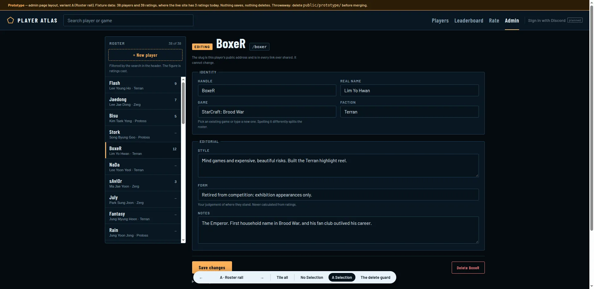
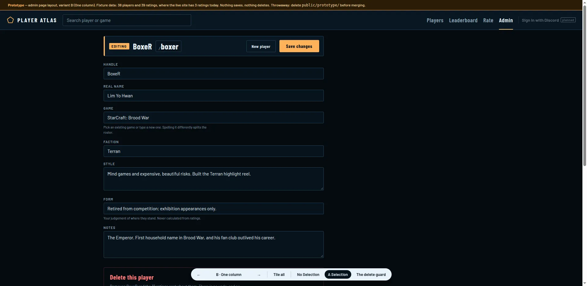
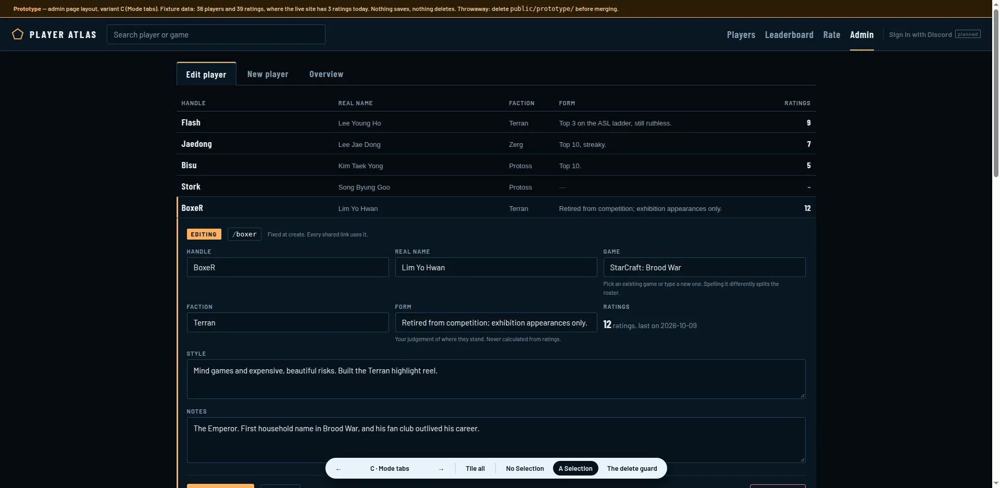
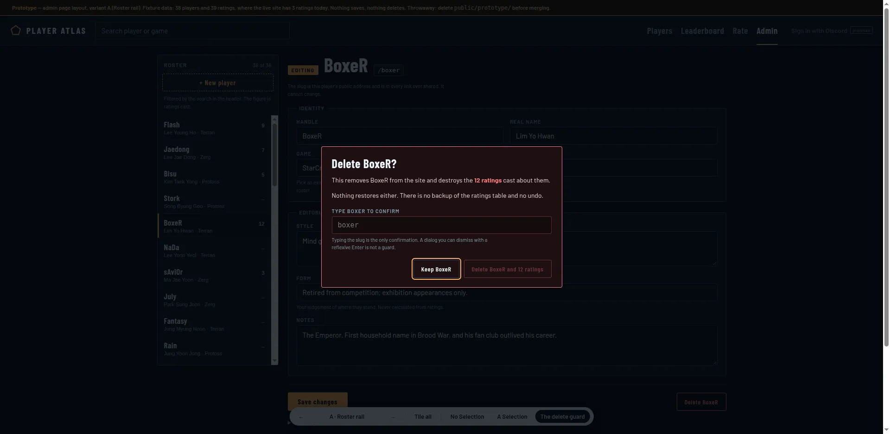
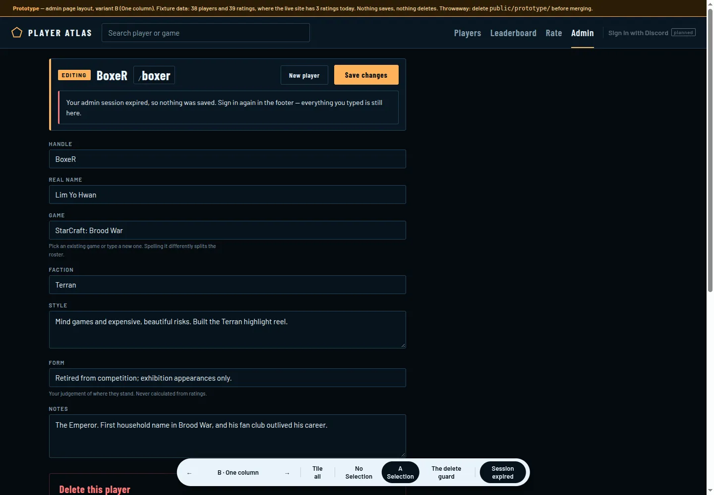

# The prototype

Throwaway code that answers one question: what does the admin page look like once a player
form lives in it. Three layouts, three states each, switchable in the browser.

## Running it

The code lives on the branch `prototype/admin-page-layout`, not on `admin-player-crud`.

```
git switch prototype/admin-page-layout
docker compose restart atlas      # or: docker compose up, if it is not running
```

<http://localhost:8787/prototype/admin-layout>

Wrangler builds its asset manifest at startup, so `public/prototype/` 404s on an already
running container until it is restarted. That trap is in `.scratch/HANDOFF.md`.

Controls, in the floating bar at the bottom:

| | |
|---|---|
| `←` `→` | previous / next layout |
| `1` `2` `3` | no Selection · a Selection · the delete guard |
| `t` | tile all three states down the page |
| Session expired | cycles the save result: none → Saved → Session expired |

The URL carries all of it — `?variant=B&screen=delete&tile=0&msg=expired` — so any screen
is linkable. The header search is live and filters the roster in every variant.

## What is real and what is not

**Real**: the header, the footer, `styles.css`, the fonts, the 38-row roster from
`migrations/0002_players.sql`, the slug derivation (copied from `src/worker.js:261`,
including `uniqueSlug()`'s silent suffixing), and the fact that 34 of 38 players have no
`style` and no `notes`.

**Fixture**: 39 ratings spread over 7 players. The live site has **3 ratings on 3
players**. The guard has to be judged where something is at stake, not where deleting
BoxeR costs one row.

**Absent**: every API call. Nothing saves and nothing deletes.

## Why it is on a branch of its own

`public/` is served to the live public site by Workers Assets. A merge to `main` would
deploy this page to `www.esports-player-atlas.workers.dev/prototype/admin-layout`, where it
is a convincing admin screen with a working-looking Delete button. So it is kept as a
primary source on `prototype/admin-page-layout` and is absent from `admin-player-crud`.

Do not merge that branch. If it is ever opened again, it stays a prototype: the winning
layout gets rewritten properly in `public/app/views.js`, not promoted from here. It has no
tests, no error handling and no `name` or `id` on a single form field.

## The three variants

### A — Roster rail



Two columns: the roster on the left, the form on the right. The page is a workspace you
stay in. The stat cards shrink to one line at the bottom, and the ratings table becomes a
per-player disclosure under the form.

- **New player** is a pinned row at the top of the rail, above the roster it replaces.
- The rail is the *result list* of the header search, not a second search box — which
  honours decision 3 while still giving the admin a visible roster.
- Mode shows as a filled `EDITING` tag beside a large handle, or a dashed `NEW PLAYER` tag
  beside the handle as you type it.
- The save result lands under the buttons that caused it.

### B — One column



The form *is* the page. No roster on screen at all: the picker is an overlay under the
header search. Today's content — stat cards and the ratings table — survives untouched,
pushed below the form as a Site overview.

- A sticky bar carries the mode, the handle, the slug, New player and Save, so the answer
  to "what am I editing" is always on screen.
- Delete is a danger zone at the end of the document, and the guard expands in place
  rather than appearing as a modal.
- The save result sits **inside the sticky bar**, which is the only one of the three that
  stays visible from the bottom of a long form.

### C — Mode tabs



Three tabs — Edit player, New player, Overview. The roster is a full-width table with a
`Form` column, and the form opens as a drawer inside the row you clicked.

- Mode is a tab, so it cannot be mistaken. This is the one variant that **contradicts
  decision 4**: the tab is the control, and the Selection follows it rather than the other
  way round.
- Overview is where today's stats and ratings table go, unchanged.
- The drawer has room for a read-only `Ratings` cell — the first time rating data appears
  inside the edit surface, which the map lists as open fog.
- Delete confirms in the row itself.

### The guard, in all three



Decision 8, built the same way everywhere and only presented differently (A: modal,
B: inline danger zone, C: in the row):

- Names the player, states the exact rating count, says there is no undo and no backup.
- Delete is disabled until the slug is typed **exactly**.
- `Enter` inside the confirm field is swallowed. The focused control is **Keep BoxeR**, so
  a reflexive Enter cancels.
- Escape cancels, because cancelling is safe.
- The button reads `Delete BoxeR and 12 ratings`, not `Confirm`.

### The save result



Not in the ticket, but ticket 03 is blocked on it being a question about the page. Each
variant has to put the answer somewhere, and the ugly case is the 401: the admin token
lives 8 hours and `signOutAdmin()` currently throws the page back to Players, taking a
filled form with it. The copy states the opposite as the requirement — *everything you
typed is still here* — so the implementation has to make it true.
